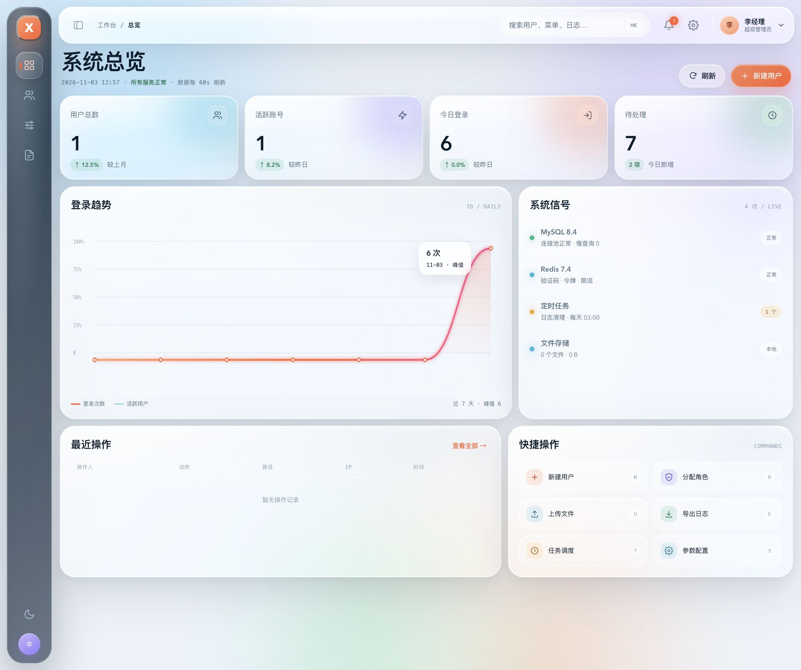
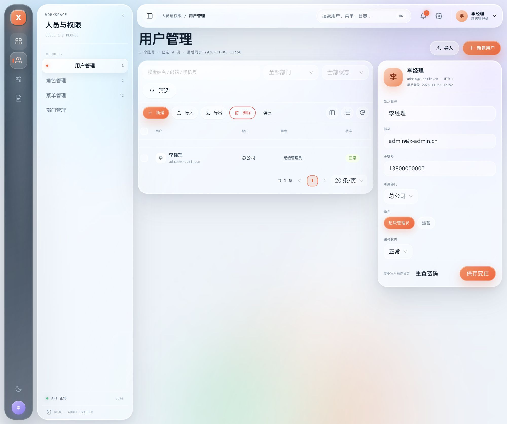
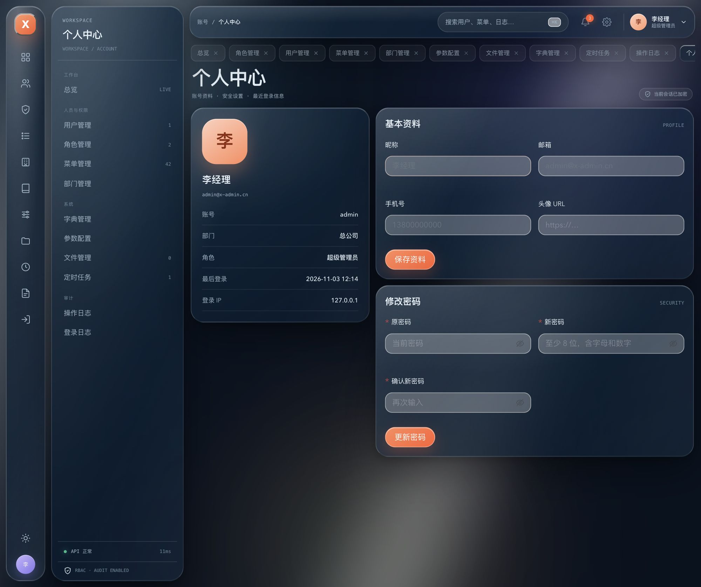

# x-admin

通用 RBAC 管理后台。后端 Go + Gin + GORM + MySQL + Redis，前端 React 19 + antd 6 + Vite 8。
视觉采用 `design-preview/02-workbench.html` 的 **Workbench Liquid Glass**：液态玻璃、极光光场、跟随鼠标的高光。

## 快速开始

### Docker Compose（完整栈）

```bash
cp .env.example .env            # 可选，覆盖 MySQL 密码 / JWT secret
docker compose -f deploy/docker-compose.yml up -d --build
open http://localhost           # 前端
open http://localhost:8080/swagger/index.html
```

初始化迁移会自动执行，包含种子数据。

### 本地开发

```bash
# 1. 基础设施（MySQL 8.4 + Redis 7.4）
docker compose -f deploy/docker-compose.dev.yml up -d

# 2. 后端（:8080）
go run ./cmd/server -config configs/config.yaml

# 3. 前端（:5173，已代理 /admin/v1）
cd frontend && npm install && npm run dev
```

本地没有 Redis 时，把 `configs/config.yaml` 的 `redis.driver` 改成 `memory` 可先跑通；
生产必须使用 Redis（refresh 白名单、验证码、限流都依赖它）。

**种子账号**：`admin` / `Admin@123456`。首次登录后建议修改密码。

## 目录

```
cmd/server/                进程入口
internal/
  bootstrap/               装配 DB / Redis / repo / service / router
  config/                  YAML + X_ADMIN_* 环境变量
  model/                   GORM 模型与查询过滤器
  repository/              GORM 实现 + 泛型 Base[T]
  service/                 业务逻辑 + ports.go 端口接口
  handler/                 HTTP 绑定 / 响应
  middleware/              request-id / auth / permission / rate-limit / audit
  router/                  路由与 Swagger 静态页
  pkg/                     可复用基础模块
    apperr response pagination requestid security cache captcha storage excel tree authn
  docs/                    OpenAPI 3 + Swagger UI
migrations/                golang-migrate SQL（embed 到二进制）
tests/                     全部 Go 测试
frontend/                  React SPA
deploy/                    Dockerfile / Nginx / Compose
design-preview/            三套视觉样张（02 已选定）
```

## 功能

- 登录 / 退出 / refresh 轮换 / 当前用户与权限
- 看板：用户、角色、菜单、文件、任务、7 日登录趋势、最近操作
- 用户：分页筛选、增删改、状态、重置密码、角色分配、Excel 导入导出
- 角色：CRUD、菜单权限树
- 菜单：目录 / 菜单 / 按钮三级，权限码
- 部门：树形组织，删除前检查子级与成员
- 字典：类型 + 字典项
- 参数：键值配置，`public` 控制匿名读取
- 文件：本地磁盘 `data/uploads`，存储层接口可替换
- 定时任务：robfig/cron，启停、立即执行、最近结果
- 操作日志 / 登录日志：分页、删除、清空
- 个人中心：资料、密码
- 前端：一级图标轨 / 二级上下文栏（单页模块自动收起并播放 motion 动画）、多标签页、暗色模式、列设置、密度、全局水印、Mock 开关、⌘K 导航

## 测试

所有测试都在 `tests/`：

```bash
make test          # go test ./tests/...
make coverage      # 覆盖率汇总
make coverage-html # 生成 coverage.html
```

- `tests/unit/pkg`：错误、分页、JWT、密码、缓存（含 miniredis）、验证码、存储、Excel、树
- `tests/unit/service`：认证、用户、角色、菜单、部门、字典、参数、文件、任务、日志、看板、个人中心
- `tests/unit/middleware`：request-id、recovery、CORS、认证、权限、限流、审计脱敏
- `tests/unit/database`：迁移辅助与健康检查
- `tests/unit/repository`：日志保留策略等仓储行为
- `tests/integration`：SQLite + 内存缓存跑完整 HTTP 登录与 CRUD 链路，以及全部 handler 的校验分支
- `tests/testsupport`：可复用的测试装配（SQLite / 内存缓存 / 完整 Router）

当前统计口径（`-coverpkg=./internal/...`）为 **85.4%**：
`internal/pkg` 约 95%、service 89.7%、repository 93.1%、middleware 96.8%、handler 80.7%。
剩余未覆盖主要是 MySQL 连接失败、随机数失败、`main` 启动等不可注入分支。
新增业务请同步补测试；`make coverage` 可直接复现。

## 配置

优先级：默认值 < `configs/config.yaml` < `X_ADMIN_*` 环境变量。

| 环境变量 | 说明 |
| --- | --- |
| `X_ADMIN_APP_ENV` | `development` / `production` |
| `X_ADMIN_SERVER_PORT` | 默认 8080 |
| `X_ADMIN_DATABASE_DSN` | MySQL DSN |
| `X_ADMIN_REDIS_DRIVER` | `redis` / `memory` |
| `X_ADMIN_REDIS_ADDR` | Redis 地址 |
| `X_ADMIN_JWT_SECRET` | 至少 16 字符；生产禁止默认值 |
| `X_ADMIN_JWT_ACCESS_TTL` | 默认 2h |
| `X_ADMIN_JWT_REFRESH_TTL` | 默认 168h |
| `X_ADMIN_STORAGE_ROOT` | 默认 `data/uploads` |
| `X_ADMIN_STORAGE_MAX_MB` | 单文件上限，默认 20 |
| `X_ADMIN_CORS_ORIGINS` | 逗号分隔 |

## 安全与审计

- bcrypt cost 10；密码至少 8 位且包含字母与数字。
- access JWT 2h；refresh 为 32 字节随机串，Redis 白名单 7d，每次刷新轮换。
- 验证码 5 分钟、一次性；登录失败 5 次锁定 15 分钟。
- 全局限流 100/min/IP，登录 10/min/IP。
- 写操作自动审计：操作人、路径、IP、状态、耗时、请求体；密码 / token / captcha 字段脱敏。
- 超级管理员 `super_admin` 绕过权限判断；其余角色按菜单权限码授权。

## API

- 前缀：`/admin/v1`
- 响应：`{ "code": 0, "message": "ok", "data": ..., "request_id": "..." }`
- Swagger UI：`/swagger/index.html`
- OpenAPI：`internal/docs/openapi.yaml`

## 构建

```bash
make build              # bin/x-admin
make frontend-build     # frontend/dist
make lint               # go vet + oxlint
```

## 设计






视觉样张保留在 `design-preview/`，实现以 `frontend/src/styles/global.css` 为准：

- 两级导航：左侧图标轨是一级模块，右侧上下文栏只显示当前模块的二级页面；模块只有 0/1 个页面时自动收起，把 222px 让给内容区，展开/收起由 `motion` 驱动
- 背景 `#edf3f9` / 深色 `#07131f`
- ink `#0b1c2c`、accent `#ff5f33`、violet `#8b7cf6`、cyan `#2fb8d9`、mint `#2fb98a`
- 字体 Avenir Next / SF Pro Display / PingFang SC；数字 tabular-nums
- 玻璃：`backdrop-filter: blur(28px) saturate(170%)` + 方向性高光边框 + 鼠标光斑
