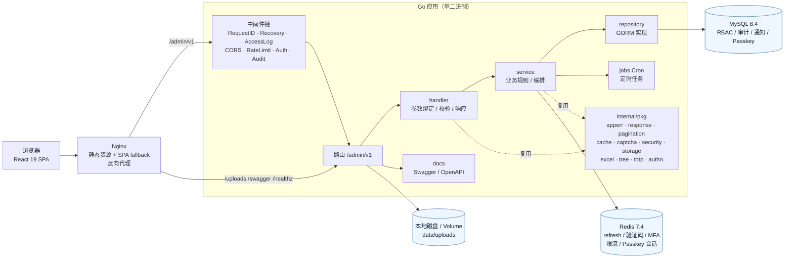
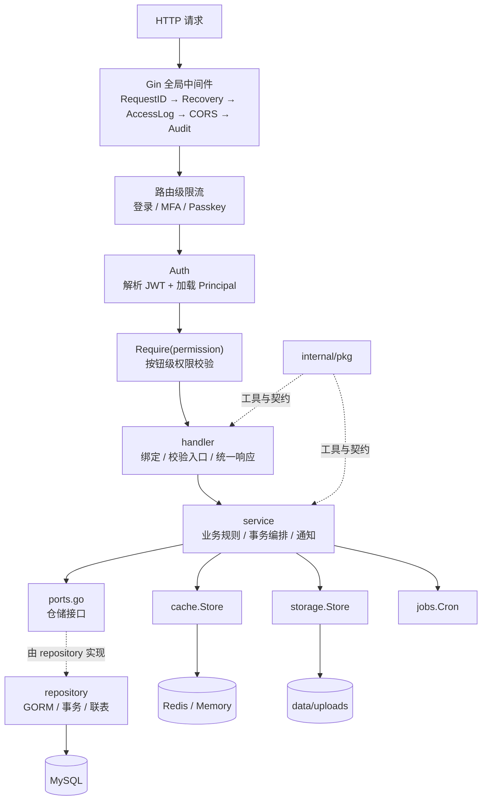
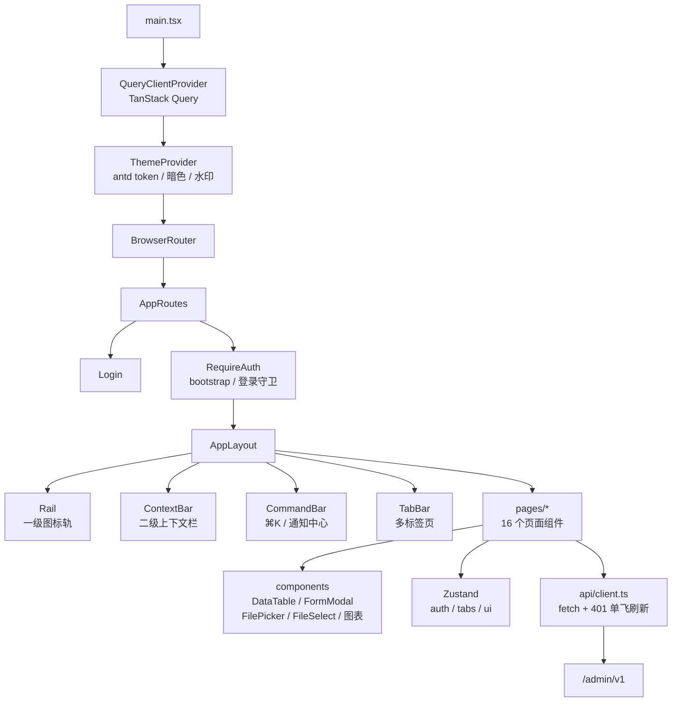
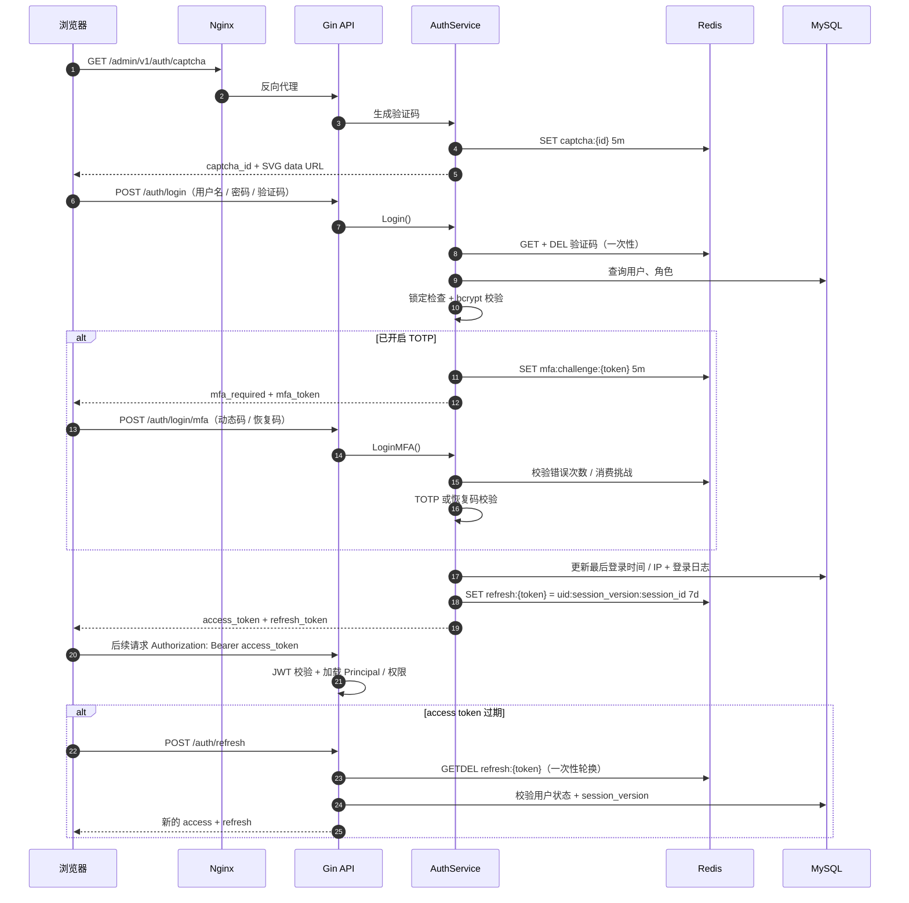
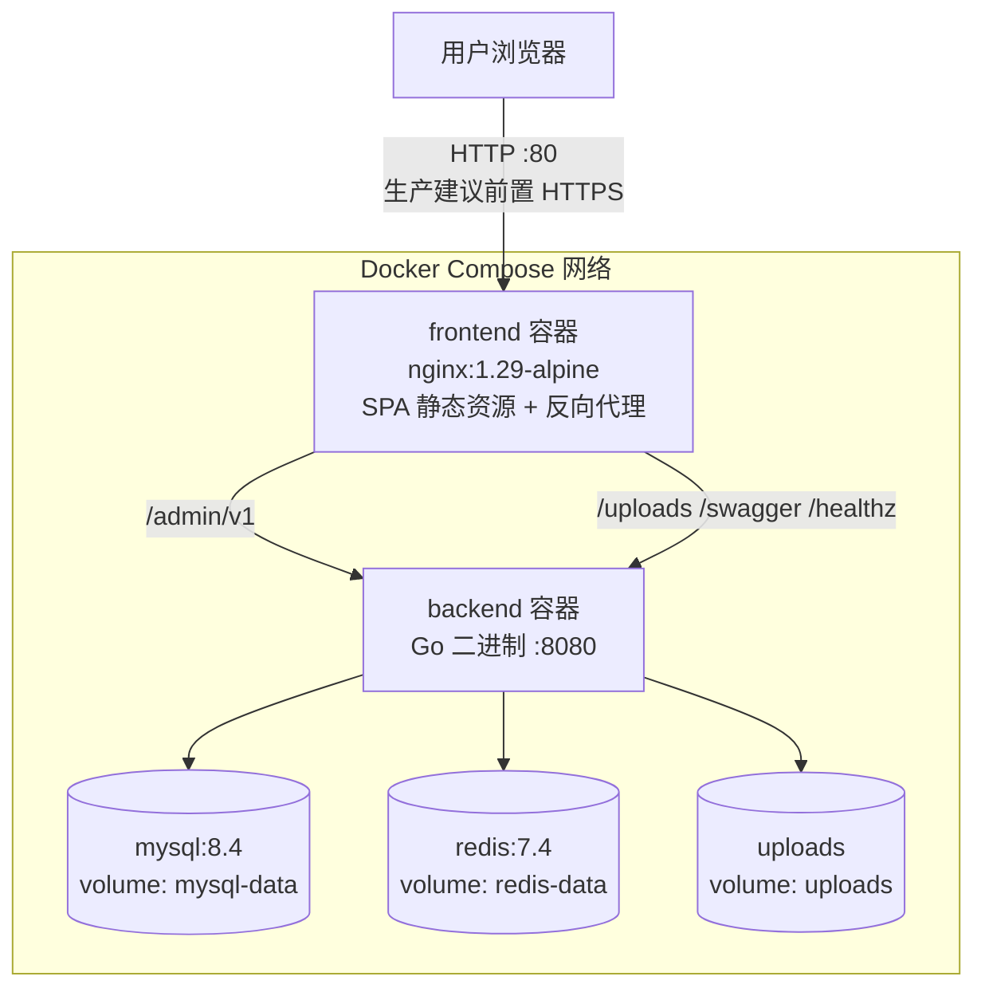
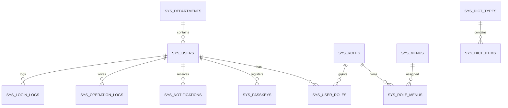
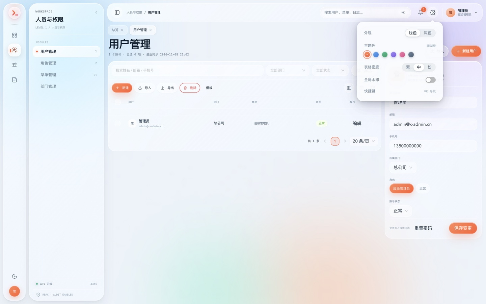

# x-admin

> 通用 RBAC 管理后台 · Go + React 前后端分离 · Workbench Liquid Glass 视觉

x-admin 是一套可直接用于中后台系统的全栈脚手架：后端提供认证、权限、组织架构、字典参数、文件、定时任务、审计与站内通知；前端提供完整的 SPA 工作台、两级导航、多标签页、暗色模式与可复用业务组件。


[](https://github.com/xgd16/x-admin/actions/workflows/ci.yml)
[](https://github.com/xgd16/x-admin/actions/workflows/release.yml)

## 目录

- [1. 项目简介](#1-项目简介)
- [2. 技术栈](#2-技术栈)
- [3. 系统架构](#3-系统架构)
- [4. 功能模块](#4-功能模块)
- [5. 快速开始](#5-快速开始)
- [6. 目录结构](#6-目录结构)
- [7. 后端说明](#7-后端说明)
- [8. 前端说明](#8-前端说明)
- [9. 测试与质量](#9-测试与质量)
- [10. 部署](#10-部署)
- [11. 常见问题](#11-常见问题)
- [12. 开发约定](#12-开发约定)
- [13. 截图与设计](#13-截图与设计)
- [14. 开源协议](#14-开源协议)

---

## 1. 项目简介

- **前后端分离**：React SPA 由 Nginx 托管，后端以 `/admin/v1` 统一前缀提供 JSON API。
- **RBAC 权限模型**：用户 → 角色 → 菜单/按钮；`super_admin` 跳过权限判断，其余按权限码授权。
- **开箱即用的安全能力**：图形验证码、登录锁定、JWT + refresh 轮换、TOTP 双重验证、一次性恢复码、Passkey（WebAuthn）、限流、操作审计。
- **完整业务模块**：看板、用户、角色、菜单、部门、字典、参数、文件、定时任务、操作/登录日志、个人中心、站内通知。
- **可复用基础包**：错误码、统一响应、分页、缓存、验证码、JWT、密码哈希、Excel、树、存储、TOTP。
- **工程化**：版本化 SQL 迁移嵌入二进制、Swagger/OpenAPI、Go 单元与集成测试、前端 Vitest 测试、Docker Compose 一键部署。

实现契约见 [`SPEC.md`](./SPEC.md)，接口描述见 [`internal/docs/openapi.yaml`](./internal/docs/openapi.yaml)。

---

## 2. 技术栈

### 2.1 后端

| 分类 | 选型 | 说明 |
| --- | --- | --- |
| 语言 | Go 1.27 | 单二进制交付 |
| Web 框架 | Gin | 路由、中间件、参数绑定 |
| ORM | GORM | MySQL 访问、软删除、预加载 |
| 数据库 | MySQL 8.4 | 业务数据与审计日志 |
| 缓存 | Redis 7 / 内存实现 | refresh 白名单、验证码、MFA 挑战、Passkey 会话、限流 |
| 认证 | golang-jwt v5 | HS256 access token，2 小时 |
| 密码 | bcrypt | cost 10 |
| 迁移 | golang-migrate + embed | 启动时自动执行 |
| 定时任务 | robfig/cron v3 | 进程内调度，标准 5 段 Cron |
| Passkey | go-webauthn | WebAuthn 注册与免密码登录 |
| 监控 | gopsutil v4 | 主机 CPU/内存/磁盘/网络采集 |
| 文档 | OpenAPI 3 + Swagger UI | `/swagger/index.html` |
| Excel | excelize v2 | 用户导入导出 |

### 2.2 前端

| 分类 | 选型 | 说明 |
| --- | --- | --- |
| 框架 | React 19 + TypeScript 7 | 函数组件 + Hooks |
| 构建 | Vite 8 | 开发代理、生产构建 |
| UI | antd 6 | 中文语言包、主题 token |
| 路由 | React Router 7 | 嵌套路由 + 登录守卫 |
| 数据请求 | TanStack Query 5 | 缓存、失效、轮询、分页 |
| 状态 | Zustand 5 | auth / tabs / ui 三个 store |
| 图表 | ECharts 6 | 登录趋势图 |
| 动画 | motion 14 | 布局滑动、页面入场，尊重 `prefers-reduced-motion` |
| 时间 | dayjs | 相对时间与格式化 |
| 测试 | Vitest 5 + Testing Library + jsdom | 组件与工具函数测试 |
| Lint | oxlint | `npm run lint` |

### 2.3 基础设施与部署

- Docker / Docker Compose
- Nginx（SPA 静态资源、Gzip、反向代理、SPA fallback）
- MySQL 8.4、Redis 7.4（Compose 内置健康检查）

---

## 3. 系统架构

### 3.1 总体架构



**关键点**

- 后端只有一个进程、一个二进制；HTTP 服务与 Cron 调度同进程运行。
- MySQL 保存持久业务数据；Redis 保存所有短期状态与登录白名单，生产环境不可用内存实现替代。
- 上传文件默认落在本地磁盘，通过 `storage.Store` 接口可替换为对象存储。
- Swagger 页面资源来自 CDN，内网离线部署时需自行托管静态资源。

### 3.2 后端分层



**一次请求的生命周期**

1. `RequestID` 复用或生成 `X-Request-ID`，写入上下文与响应头。
2. `Recovery` 捕获 panic，记录堆栈并返回统一 500。
3. `AccessLog` 记录方法、路径、状态码、耗时、IP。
4. `CORS` 按白名单写入跨域头，直接处理 OPTIONS 预检。
5. `Audit` 仅捕获写操作（POST/PUT/PATCH/DELETE，排除 `/auth/*`），异步落审计表。
6. 全局限流 100/min/IP；登录、MFA、Passkey 路由叠加更严格限流。
7. `Auth` 校验 Bearer token，重新加载用户与权限，确保停用/角色变更立即生效。
8. `Require("模块:资源:动作")` 做按钮级授权。
9. `handler → service → repository` 完成业务，统一返回 `{code, message, data, request_id}`。

**分层硬规则**

- handler 不直接访问 GORM，只做绑定、校验入口和响应。
- service 不接触 `*gin.Context`，只依赖 `ports.go` 中的接口。
- 可复用能力一律下沉到 `internal/pkg`，不复制分页、树、错误、存储逻辑。
- 每个 repository 只暴露 service 需要的方法。

### 3.3 前端架构



**关键点**

- 所有页面都在 `RequireAuth` 内，首次进入先 `bootstrap()` 拉取 `/auth/me`。
- `AppLayout` 根据当前路径自动打开标签页；标签页存入 `sessionStorage`，刷新页面后保留。
- 请求统一走 `api/client.ts`：自动附带 access token，401 时只发起一次 refresh，成功后重放原请求。
- 服务端数据全部交给 TanStack Query 管理，页面不自行维护重复的 loading/error 状态。

### 3.4 登录与令牌时序



Passkey 登录使用同样的令牌签发逻辑，但校验方式不同：`/auth/passkey/login/begin` 生成 discoverable credential 参数，`/finish` 校验签名与计数器后直接签发令牌。

> 若要为前台（C 端）用户增加一套独立身份体系（独立账号表、令牌与后台互不通用），完整实现演示见 [`docs/front-auth.md`](./docs/front-auth.md)。

### 3.5 部署拓扑



- `frontend` 对外暴露 80；`backend` 暴露 8080（便于直接访问 Swagger 与排查）。
- MySQL / Redis 仅在 Compose 内网暴露，不映射宿主机端口。
- 生产环境建议在 frontend 前再加一层负载均衡或云厂商 HTTPS 终止。

### 3.6 RBAC 数据模型



权限计算方式：用户角色 → 角色菜单 → 菜单上的 `permission` 字段。`super_admin` 直接拥有全部启用菜单与权限。

---

## 4. 功能模块

| 模块 | 功能 | 权限码 |
| --- | --- | --- |
| 认证 | 验证码、密码登录、TOTP 二次验证、Passkey 登录、刷新、退出、当前用户 | 登录接口公开 |
| 看板 | 用户/角色/菜单/文件/任务统计、7 日登录趋势、最近操作 | `dashboard:view` |
| 用户 | 分页筛选、增删改、状态、重置密码、角色分配、Excel 导入、列表异步导出 | `system:user:*` |
| 在线用户 | 管理员查看全部在线会话、设备/IP/登录时间、强制下线单设备或整用户 | `system:online:list` `system:online:kick` |
| 角色 | CRUD、菜单权限树、内置角色保护 | `system:role:*` |
| 菜单 | 目录/菜单/按钮三级、权限码、树形防环 | `system:menu:*` |
| 部门 | 树形组织、子部门/成员删除检查 | `system:dept:*` |
| 字典 | 类型 + 字典项、编码唯一 | `system:dict:*` |
| 参数 | 键值配置、`public` 控制对外读取 | `system:param:*` |
| 系统监控 | 主机 CPU/内存/磁盘/网络、Go 运行时、数据库连接池与缓存探测 | `system:monitor:view` |
| 文件 | 上传、列表、下载、删除、按类型筛选、文件库选择器 | `system:file:*` |
| 定时任务 | CRUD、启停、立即执行、最近结果、执行历史 | `system:job:*` |
| 操作日志 | 分页、筛选、删除、清空 | `system:log:operation` |
| 登录日志 | 分页、筛选、清空 | `system:log:login` |
| 异步导出 | 提交导出任务、进度轮询、取消、下载、文件名模板、导出记录页（[设计说明](./docs/export.md)） | `system:export:*` |
| 个人中心 | 资料、密码、TOTP、恢复码、Passkey 设备管理 | 登录即可 |
| 站内通知 | 未读数、列表、单条/全部已读、业务提醒 | 登录即可 |

### 权限码

```
dashboard:view

system:user:list   system:user:create   system:user:update   system:user:delete
system:user:reset  system:user:import   system:user:export

system:role:list   system:role:create   system:role:update   system:role:delete  system:role:assign
system:menu:list   system:menu:create   system:menu:update   system:menu:delete
system:dept:list   system:dept:create   system:dept:update   system:dept:delete
system:dict:list   system:dict:create   system:dict:update   system:dict:delete
system:param:list  system:param:create  system:param:update  system:param:delete
system:file:list   system:file:upload   system:file:download system:file:delete
system:job:list    system:job:create    system:job:update    system:job:delete   system:job:run
system:log:operation
system:log:login
system:export:list system:export:submit system:export:cancel system:export:delete
system:export:download system:export:config

system:online:list  system:online:kick
system:monitor:view
```

---

## 5. 快速开始

### 5.1 环境要求

| 依赖 | 版本 |
| --- | --- |
| Go | 1.27+ |
| Node.js | 22.12+（Docker 构建使用 Node 26） |
| MySQL | 8.4（或 8.0+） |
| Redis | 7.x（生产必需） |
| Docker | 可选，用于一键启动完整栈 |

### 5.2 Docker Compose（完整栈）

```bash
cp .env.example .env
# 编辑 .env：至少填写 JWT_SECRET（建议 32+ 位随机字符），否则 Compose 会拒绝启动
docker compose -f deploy/docker-compose.yml up -d --build

open http://localhost                          # 前端
open http://localhost:8080/swagger/index.html  # Swagger
```

启动时后端会自动执行迁移与种子数据。默认账号：

```text
用户名：admin
密码：  Admin@123456
```

停止服务（保留数据卷）：

```bash
docker compose -f deploy/docker-compose.yml down
```

> 需要清空 MySQL / Redis / 上传文件时再使用 `down -v`，该操作不可恢复。

### 5.3 本地开发

```bash
# 0. 首次生成配置（config.yaml 不入库，改动不会被提交）
cp configs/config.example.yaml configs/config.yaml

# 1. 启动 MySQL + Redis（映射 3306 / 6379）
make dev-infra

# 2. 启动后端（:8080）
make run

# 3. 启动前端（:5173，已代理 /admin/v1 与 /uploads）
cd frontend
npm ci
npm run dev
```

打开 <http://localhost:5173>。首次启动后端会自动迁移并写入种子数据：

- 账号：`admin` / `Admin@123456`
- 角色：`super_admin`（超级管理员）、`operator`（运营）
- 部门：总公司 → 技术部 / 运营部 / 财务部
- 字典：`user_status`、`job_status`、`menu_type`
- 参数：`site.name`、`site.logo`、`upload.max_size`

本地没有 Redis 时，可把 `configs/config.yaml` 的 `redis.driver` 改为 `memory` 先跑通；该模式重启后 refresh token、验证码、限流计数都会丢失，**生产环境必须使用 Redis**。

### 5.4 常用命令

| 命令 | 说明 |
| --- | --- |
| `make run` | 本地启动后端 |
| `make build` | 编译 `bin/x-admin` |
| `make frontend` | 启动前端开发服务器 |
| `make frontend-build` | 构建前端到 `frontend/dist` |
| `make test` | 运行后端测试 |
| `make frontend-test` | 运行前端测试 |
| `make test-all` | 后端 + 前端测试 |
| `make coverage` | 后端覆盖率汇总 |
| `make coverage-html` | 生成 `coverage.html` |
| `make lint` | `go vet` + `oxlint` |
| `make fmt` | `gofmt` |
| `make wire` | 修改装配后重新生成 `wire_gen.go` |
| `make compose-up` | 启动完整 Docker Compose |
| `make compose-logs` | 查看 Compose 日志 |

---

## 6. 目录结构

```text
x-admin/
├── cmd/
│   └── server/main.go              # 进程入口：配置 → 装配 → 监听 → 优雅退出
├── internal/
│   ├── bootstrap/                  # 依赖装配：wire.go 声明 + wire_gen.go 自动生成
│   ├── config/                     # YAML + X_ADMIN_* 环境变量
│   ├── database/                   # GORM 连接、迁移、健康检查
│   ├── model/                      # GORM 模型与查询过滤器
│   ├── repository/                 # GORM 实现 + 泛型 Base[T]
│   ├── service/                    # 业务逻辑；ports.go 定义仓储接口
│   ├── handler/                    # HTTP 参数绑定、校验入口、统一响应
│   ├── middleware/                 # request-id / recovery / CORS / auth / rate-limit / audit
│   ├── router/                     # 路由、权限码与 Swagger 静态页
│   ├── jobs/                       # robfig/cron 命名调度封装
│   ├── docs/                       # OpenAPI 3 + Swagger UI
│   └── pkg/                        # 可复用基础模块
│       ├── apperr/                 # 业务错误码
│       ├── authn/                  # Principal 与上下文
│       ├── cache/                  # Redis / 内存 Store
│       ├── captcha/                # SVG 图形验证码
│       ├── excel/                  # xlsx 读写
│       ├── pagination/             # 分页参数
│       ├── requestid/              # 请求 ID
│       ├── response/               # 统一响应信封
│       ├── security/               # JWT / bcrypt / 随机令牌
│       ├── storage/                # 文件存储抽象 + 本地实现
│       ├── totp/                   # TOTP + 恢复码
│       └── tree/                   # 通用树构建
├── migrations/                     # golang-migrate SQL（embed 到二进制）
├── tests/                          # Go 测试（unit / integration）
│   ├── unit/                       # pkg / service / handler / middleware / database / repository / bootstrap / jobs
│   ├── integration/                # SQLite + 内存缓存的完整 HTTP 链路
│   └── testsupport/                # 测试装配
├── frontend/
│   ├── src/
│   │   ├── api/                    # client / tokens / types
│   │   ├── charts/                 # ECharts 注册、主题、趋势图配置
│   │   ├── components/             # 通用组件
│   │   │   └── layout/             # AppLayout / Rail / ContextBar / CommandBar / TabBar / NotificationCenter
│   │   ├── config/                 # 导航配置
│   │   ├── pages/                  # 16 个页面组件
│   │   ├── stores/                 # Zustand：auth / tabs / ui
│   │   ├── styles/                 # 全局 CSS 变量与玻璃视觉
│   │   ├── test/                   # Vitest setup
│   │   └── utils/                  # 文件、格式化、motion、passkey
│   ├── public/
│   ├── vite.config.ts              # 开发代理 + Vitest 配置
│   └── package.json
├── .github/workflows/              # CI 测试与 Release 多平台产物自动化
├── deploy/                         # Dockerfile / Nginx / Compose
├── docs/                           # 截图、wire 教程、异步导出说明（export.md）与前台认证演示（front-auth.md）
├── configs/config.example.yaml     # 配置模板（复制为 config.yaml，后者不入库）
├── .env.example                    # Compose 与本地开发环境变量示例
├── Makefile
├── SPEC.md                         # 实现规格
└── README.md
```

---

## 7. 后端说明

### 7.1 API 概览

统一前缀：`/admin/v1`

#### 认证（无需登录）

| 方法 | 路径 | 说明 |
| --- | --- | --- |
| GET | `/auth/captcha` | 返回 `captcha_id` + SVG data URL |
| POST | `/auth/login` | 用户名/密码/验证码；开启双重验证时返回 `mfa_token` |
| POST | `/auth/login/mfa` | 动态验证码或恢复码换取令牌 |
| POST | `/auth/passkey/login/begin` | 生成 discoverable credential 登录参数 |
| POST | `/auth/passkey/login/finish` | 校验通行密钥签名并签发令牌 |
| POST | `/auth/refresh` | refresh token 轮换 |

#### 登录后

| 方法 | 路径 | 说明 |
| --- | --- | --- |
| POST | `/auth/logout` | 删除 refresh 白名单与当前登录会话 |
| GET | `/auth/me` | 当前用户 + 权限码 + 菜单树，并续期文件访问 Cookie |
| GET/PUT | `/profile` | 个人资料 |
| PUT | `/profile/password` | 修改密码（撤销其他设备会话） |
| GET | `/profile/sessions` | 在线设备列表（含是否“记住我”） |
| DELETE | `/profile/sessions/:id` | 退出指定设备 |
| POST | `/profile/session-actions/revoke-others` | 退出除当前设备外的全部会话 |
| POST | `/profile/session-actions/revoke-all` | 退出全部会话（含当前设备） |
| GET/POST/DELETE | `/profile/totp`、`/profile/totp/setup`、`/profile/totp/enable` | 双重验证状态、绑定、开启、关闭 |
| GET/POST/PUT/DELETE | `/profile/passkeys`、`/profile/passkeys/begin`、`/profile/passkeys/finish`、`/profile/passkeys/:id` | Passkey 设备管理 |
| GET/PUT | `/notifications`、`/notifications/unread-count`、`/notifications/read-all`、`/notifications/:id/read` | 站内通知 |

#### 业务模块

| 模块 | 路径 |
| --- | --- |
| 看板 | `GET /dashboard/summary` |
| 用户 | `/users`、`/users/:id`、`/users/:id/roles`、`/users/:id/password`、`/users/:id/status`、`/users/import`、`/users/template` |
| 角色 | `/roles`、`/roles/all`、`/roles/:id`、`/roles/:id/menus` |
| 菜单 | `/menus/tree`、`/menus`、`/menus/:id` |
| 部门 | `/departments/tree`、`/departments`、`/departments/:id` |
| 字典 | `/dict/types`、`/dict/types/:id/items`、`/dict/items/:id` |
| 参数 | `/parameters`、`/parameters/:id` |
| 在线用户 | `GET /online-sessions`、`DELETE /online-sessions/:userID`（请求体可选 `session_id`） |
| 系统监控 | `GET /monitor/overview` |
| 文件 | `POST /files`、`GET /files`、`GET /files/:id/download`、`GET/POST /files/:id/shares`、`DELETE /files/:id/shares/:shareID`、`DELETE /files/:id` |
| 任务 | `GET/POST /jobs`、`PUT/DELETE /jobs/:id`、`PUT /jobs/:id/status`、`POST /jobs/:id/run`、`GET /jobs/:id/runs` |
| 操作日志 | `GET/DELETE /logs/operations`、`DELETE /logs/operations/clear`（导出走异步任务） |
| 登录日志 | `GET /logs/logins`、`DELETE /logs/logins/clear`（导出走异步任务） |
| 异步导出 | `POST/GET /export-tasks`、`POST /export-tasks/:id/cancel`、`DELETE /export-tasks/:id`、`GET /export-tasks/:id/download`、`GET/PUT /export-tasks/filename-template`；设计与扩展见 [`docs/export.md`](./docs/export.md) |

其他端点：

- `GET /parameters/public`：无需登录读取 `public=true` 的系统参数（站点名称、Logo 等）。
- `GET /healthz`：数据库 + 缓存健康检查，异常返回 503。
- `GET /swagger/index.html`：Swagger UI。
- `GET /uploads/*`：上传文件访问，必须携带登录下发的 HttpOnly 文件访问 Cookie，或 `Authorization: Bearer`。

### 7.2 统一响应与错误码

```json
{
  "code": 0,
  "message": "ok",
  "data": {},
  "request_id": "a1b2c3..."
}
```

分页 `data`：

```json
{
  "list": [],
  "total": 0,
  "page": 1,
  "page_size": 20
}
```

| code | HTTP | 含义 |
| --- | --- | --- |
| `0` | 200/201 | 成功 |
| `40001` | 400 | 参数错误 |
| `40101` | 401 | 未登录 |
| `40102` | 401 | 登录失效 |
| `40301` | 403 | 无权限 |
| `40401` | 404 | 不存在 |
| `40901` | 409 | 冲突 |
| `42301` | 423 | 账号锁定 |
| `42901` | 429 | 限流 |
| `50001` | 500 | 内部错误（不泄露内部信息） |

分页参数统一为 `page`、`page_size`（默认 1/20，上限 200）；用户、角色、字典、参数、文件、日志等列表还支持 `keyword`，各模块可追加 `status`、`dept_id`、`role_id`、`mime`、`kind`、时间范围等参数。

### 7.3 数据表

| 表 | 说明 |
| --- | --- |
| `sys_users` | 账号、密码哈希、部门、状态、最后登录、TOTP、session_version |
| `sys_roles` | 角色；`code` 唯一，`super_admin` 为内置超级管理员 |
| `sys_menus` | 目录/菜单/按钮，`permission` 为权限码 |
| `sys_departments` | 部门树 |
| `sys_user_roles` | 用户-角色关联 |
| `sys_role_menus` | 角色-菜单关联 |
| `sys_dict_types` / `sys_dict_items` | 字典类型与字典项 |
| `sys_parameters` | 系统参数 |
| `sys_files` | 上传文件元数据 |
| `sys_jobs` | 定时任务定义与最近执行结果 |
| `sys_job_runs` | 任务执行历史（手动/定时、结果、耗时），默认保留 30 天 |
| `sys_export_tasks` | 异步导出任务：状态、进度、产物文件信息，默认保留 7 天（见 [`docs/export.md`](./docs/export.md)） |
| `sys_operation_logs` | 操作审计 |
| `sys_login_logs` | 登录审计 |
| `sys_notifications` | 站内通知，按 `user_id` 归属 |
| `sys_passkeys` | WebAuthn 凭据、设备名、签名计数器 |
| `sys_file_shares` | 可撤销文件分享令牌摘要、有效期、撤销时间 |

所有业务表带 `id / created_at / updated_at / deleted_at`，默认软删除；通行密钥与日志清理使用物理删除。

### 7.4 配置

优先级：**内置默认值 < `configs/config.yaml` < `X_ADMIN_*` 环境变量**。

| 环境变量 | 默认值 | 说明 |
| --- | --- | --- |
| `X_ADMIN_APP_ENV` | `development` | `development` / `production` |
| `X_ADMIN_SERVER_HOST` | `0.0.0.0` | 监听地址 |
| `X_ADMIN_SERVER_PORT` | `8080` | 监听端口 |
| `X_ADMIN_TRUSTED_PROXIES` | 本机 + 私有网段 | 允许读取 `X-Forwarded-For` / `X-Real-IP` 的代理网段，逗号分隔 |
| `X_ADMIN_DATABASE_DSN` | 本地 xadmin 库 | MySQL DSN |
| `X_ADMIN_REDIS_DRIVER` | `redis` | `redis` / `memory` |
| `X_ADMIN_REDIS_ADDR` | `127.0.0.1:6379` | Redis 地址 |
| `X_ADMIN_REDIS_PASSWORD` | 空 | Redis 密码 |
| `X_ADMIN_REDIS_DB` | `0` | Redis 库号 |
| `X_ADMIN_JWT_SECRET` | 开发默认值 | 至少 16 字符；生产禁止使用默认值 |
| `X_ADMIN_JWT_ISSUER` | `x-admin` | JWT 签发者 |
| `X_ADMIN_JWT_ACCESS_TTL` | `2h` | access token 有效期 |
| `X_ADMIN_JWT_REFRESH_TTL` | `168h` | 勾选“记住我”时的 refresh token 有效期 |
| `X_ADMIN_JWT_SESSION_TTL` | `12h` | 未勾选“记住我”时的 refresh token 有效期 |
| `X_ADMIN_STORAGE_ROOT` | `data/uploads` | 上传根目录 |
| `X_ADMIN_STORAGE_URL_PREFIX` | `/uploads` | 访问前缀 |
| `X_ADMIN_STORAGE_MAX_MB` | `20` | 单文件大小上限 |
| `X_ADMIN_WEBAUTHN_RP_ID` | `localhost` | Passkey 依赖方域名，不带协议和端口 |
| `X_ADMIN_WEBAUTHN_RP_DISPLAY_NAME` | `x-admin` | 认证器显示名称 |
| `X_ADMIN_WEBAUTHN_RP_ORIGINS` | `http://localhost,http://localhost:5173` | 允许的完整来源，逗号分隔 |
| `X_ADMIN_CORS_ORIGINS` | `http://localhost:5173` | 跨域白名单，逗号分隔 |

YAML 中的 `database.auto_migrate` 控制启动时是否执行迁移（默认 `true`）；生产升级前建议先备份数据库。

Compose 额外变量（`.env`）：

| 变量 | 默认值 | 说明 |
| --- | --- | --- |
| `MYSQL_ROOT_PASSWORD` | `root` | MySQL root 密码 |
| `MYSQL_PASSWORD` | `xadmin` | 业务账号密码 |
| `JWT_SECRET` | 无，必填 | 生产必须设置随机值；留空时 Compose 拒绝启动 |
| `WEBAUTHN_RP_ID` | `localhost` | 生产改为真实域名 |
| `WEBAUTHN_RP_DISPLAY_NAME` | `x-admin` | 认证器显示名 |
| `WEBAUTHN_RP_ORIGINS` | `http://localhost,http://localhost:5173` | 生产改为 `https://你的域名` |

### 7.5 安全机制

- bcrypt cost 10；密码至少 8 位且同时包含字母与数字。
- access token：HS256，默认 2h，claims 含 `uid`、`username`、`session_version`、`session_id`、`iss`、`exp`、`jti`；中间件同时校验会话版本与登录会话是否存在。
- refresh token：32 字节随机串，Redis 值为 `uid:session_version:session_id:remember`；勾选“记住我”默认 7d，未勾选默认 12h；每次刷新原子读取并删除，旧 token 立即失效。
- 图形验证码：5 分钟、一次性，校验失败也会消费。
- 登录锁定：同一用户名连续失败 5 次锁定 15 分钟，并发送站内安全提醒。
- 双重验证：RFC 6238 TOTP（SHA1 / 6 位 / 30 秒，±1 步容差）；10 个一次性恢复码只存 SHA-256 摘要。
- 两步登录：密码通过后签发 5 分钟 `mfa:challenge:*`，单个挑战错误 5 次即作废。
- 会话版本：开启/关闭双重验证、修改密码、管理员重置密码、启停账号时递增 `session_version`；access token 内含版本号，旧令牌立即失效。发起安全操作的设备会把当前 refresh token 同步到新版本。
- 在线设备：每次登录生成独立 `session_id`，可在个人中心查看设备、单独退出、退出其他设备或全部退出；撤销后对应 access token、refresh token 与文件访问 Cookie 立即失效。
- Passkey：注册需当前密码，最多 10 台设备；挑战 5 分钟一次性；服务端只保存公钥与签名计数器，私钥留在设备。
- 限流：全局 100/min/IP；登录 10/min/IP；MFA 20/min/IP；Passkey 20/min/IP。
- 审计：写操作记录操作人、路径、IP、状态、耗时、请求体；密码、token、secret、captcha、`otp_code` 自动脱敏。
- 文件：随机文件名、扩展名清洗、路径穿越校验、MIME 嗅探；`/uploads` 需要登录凭证，浏览器通过 HttpOnly Cookie 访问，`CSP sandbox` 与 `nosniff` 防止上传内容被当作主动页面执行。
- `super_admin` 跳过权限判断；其余角色按菜单权限码授权。
- 授权范围：非超级管理员只能授予自己已经拥有的菜单权限，也不能把权限高于自己的角色分配给用户，避免横向提权。
- 内置保护：`admin` 账号不可停用/删除，`super_admin` 角色编码不可修改且不可删除；同时禁止停用或删除当前登录账号。
- 多端隔离扩展：为前台（C 端）用户增加独立认证（独立用户表 + 第二 issuer 令牌管理器 + `front:` 缓存前缀）的完整演示见 [`docs/front-auth.md`](./docs/front-auth.md)。

### 7.6 文件存储

- 元数据存 `sys_files`，业务表只存 URL。
- 默认落盘路径 `data/uploads/YYYY/MM/<16-byte-random>.<ext>`。
- `POST /files` 请求体硬上限 64MB，业务上限由 `storage.max_upload_mb` 控制（默认 20MB）。
- 列表支持 `keyword`、`mime` 前缀、`kind`（`image`、`video`、`audio`、`document`、`archive`、`other`，可逗号组合）。
- 下载使用流式响应，并设置兼容中文的文件名。
- `/uploads` 不再匿名开放：登录后由 `/auth/me` 下发 `HttpOnly` 文件访问 Cookie；API 客户端可使用 Bearer token。撤销会话或递增 `session_version` 后访问凭证立即失效。
- 可撤销分享：`POST /files/:id/shares` 生成随机令牌链接（默认 1 小时，最长 7 天），数据库只保存令牌 SHA-256 摘要；未登录用户可在有效期内直接下载。`DELETE /files/:id/shares/:shareID` 撤销后链接立即失效；文件页「分享」抽屉可复制新链接、查看历史并逐条撤销。
- 多副本部署时需使用共享卷或替换 `storage.Store` 为对象存储。

### 7.7 定时任务

内置 handler：

| Handler | 参数 | 说明 |
| --- | --- | --- |
| `clean_logs` | `{"days":90}` | 物理删除超过保留期的操作/登录日志 |
| `clean_notifications` | `{"days":90}` | 物理删除超过保留期的站内通知 |
| `noop` | 无 | 空任务，用于验证调度链路 |

- 使用标准 5 段 Cron：`分 时 日 月 周`。
- 应用启动时把 `status=1` 的任务注册到调度器；修改/启停/删除会同步增删调度。
- 执行失败会写入 `last_result`，不会让调度器反复重试。
- 每次手动/Cron 执行都会写入 `sys_job_runs`，记录触发方式、状态、耗时与错误摘要；页面「记录」可查看分页历史，默认保留 30 天。
- **多副本注意**：调度器运行在进程内；启用 Redis 后，每次执行会先抢占 `job:lock:<id>` 缓存锁（30 分钟兜底过期），同一任务在多副本间只会执行一次。若使用内存缓存，仍需单副本运行。

---

## 8. 前端说明

### 8.1 工程与脚本

```bash
cd frontend
npm ci            # 安装依赖
npm run dev       # http://localhost:5173
npm run build     # tsc -b && vite build → dist/
npm run preview   # 预览生产构建
npm run lint      # oxlint
npm test          # vitest run
npm run test:coverage  # vitest run --coverage（@vitest/coverage-v8）
npm run test:watch
```

开发代理（`vite.config.ts`）：

| 前缀 | 目标 |
| --- | --- |
| `/admin/v1` | `http://127.0.0.1:8080` |
| `/uploads` | `http://127.0.0.1:8080` |

可选环境变量 `VITE_API_BASE`：默认 `/admin/v1`，用于前端独立部署到其他域名或网关路径。

### 8.2 路由

| 路径 | 页面 | 进入条件 |
| --- | --- | --- |
| `/login` | `Login` | 公开 |
| `/dashboard` | `Dashboard` | `dashboard:view` |
| `/system/users` | `Users` | `system:user:list` |
| `/system/roles` | `Roles` | `system:role:list` |
| `/system/menus` | `Menus` | `system:menu:list` |
| `/system/departments` | `Departments` | `system:dept:list` |
| `/system/dicts` | `Dicts` | `system:dict:list` |
| `/system/parameters` | `Parameters` | `system:param:list` |
| `/system/files` | `Files` | `system:file:list` |
| `/system/jobs` | `Jobs` | `system:job:list` |
| `/system/online` | `Online` | `system:online:list` |
| `/system/monitor` | `Monitor` | `system:monitor:view` |
| `/system/logs/operations` | `Logs(operations)` | `system:log:operation` |
| `/system/logs/logins` | `Logs(logins)` | `system:log:login` |
| `/system/exports` | `Exports` | `system:export:list` |
| `/profile` | `Profile` | 登录即可 |
| `*` | `NotFound` | — |

侧边导航由 `/auth/me` 返回的菜单树动态生成（名称、图标、排序、分组均以后端为准），前端静态路由表只负责路径到组件的映射；按钮权限仍由 `useAuth().can(permission)` 控制，最终授权始终以后端 `Require` 为准。

### 8.3 状态管理

| Store | 持久化 | 内容 |
| --- | --- | --- |
| `useAuth` | `localStorage`（`x-admin.auth`） | 当前用户、权限码、登录状态、登录/登出/MFA/Passkey 动作 |
| `useTabs` | `sessionStorage`（`x-admin.tabs`） | 打开的标签页、当前标签、刷新计数器 |
| `useUi` | `localStorage`（`x-admin.ui`） | 明暗主题、主题色板、表格密度、水印、列设置、上下文栏展开偏好 |

Token 单独存放在 `localStorage`：

- `x-admin.access`
- `x-admin.refresh`

> 当前实现面向前后端分离 SPA，token 存于 `localStorage`。若对 XSS 防护有更高要求，可改为 HttpOnly Cookie + CSRF 方案。

### 8.4 API 客户端

`frontend/src/api/client.ts` 统一封装：

- 自动拼接 `VITE_API_BASE ?? '/admin/v1'`。
- 自动附加 `Authorization: Bearer <access>`。
- 401 时使用单飞（single-flight）刷新：并发请求只触发一次 `/auth/refresh`，成功后重放原请求；失败则清空 token 并跳转 `/login`。
- `ApiError` 携带业务 `code` 与 `message`。
- 支持 `FormData` 上传与 Blob 下载（`saveBlob` 生成临时下载链接）。
- 查询参数自动忽略 `undefined / null / ''`。

TanStack Query 默认配置：`retry: 1`、关闭窗口聚焦重取、`staleTime: 15s`；通知未读数每 60 秒轮询一次。

### 8.5 组件与布局

| 组件 | 作用 |
| --- | --- |
| `AppLayout` | 工作台骨架：氛围光、图标轨、上下文栏、命令栏、标签栏、内容区 |
| `Rail` | 一级模块图标轨，选中态使用 motion 布局滑动 |
| `ContextBar` | 当前模块的二级导航；单页模块自动收起 |
| `CommandBar` | 全局命令入口（⌘K）、主题切换、通知中心、用户菜单 |
| `TabBar` | 多标签页；右键刷新/关闭其他/关闭左侧/右侧/全部 |
| `KeepAliveOutlet` | 页签保活；已访问页面保持挂载，切换时保留筛选条件、表单状态与滚动位置，关闭页签后释放 |
| `NotificationCenter` | 未读数角标、全部/未读切换、单条与全部已读 |
| `DataTable` | 列显隐持久化、密度切换、刷新、分页、选择、展开；窄屏自动切换卡片列表 |
| `MobileRecordList` | 手机密集数据卡片：复用表格列定义，支持选择、树形展开、操作列与分页 |
| `FormModal` | antd Form + Modal 的新增/编辑弹窗封装 |
| `FilePicker` | 文件库选择弹窗，支持类型过滤、搜索、分页、跨页保留、直接上传 |
| `FileSelect` | 表单字段封装，`value/onChange` 为 URL 或 URL[] |
| `LoginTrendChart` | 登录趋势图，悬停吸附与 tooltip |
| `StatusTag` / `PageHeader` / `Icon` / `BrandMark` | 状态标签、页头、图标、品牌标识 |

#### 文件选择器用法

```tsx
// 表单字段：value / onChange 为 URL 或 URL[]，可直接交给 Form.Item
<Form.Item name="avatar" label="头像">
  <FileSelect types="image" />
</Form.Item>

// 多选：最多 8 个图片或视频
<FileSelect types={['image', 'video']} multiple limit={8} />

// 只要选择弹窗时，用 FilePicker 拿完整 FileItem[]
<FilePicker
  open={open}
  types="image"
  multiple={false}
  onCancel={() => setOpen(false)}
  onConfirm={(files) => save(files[0])}
/>
```

- `types`：`image`、`video`、`audio`、`document`、`archive`、`other`，可传单值或数组。
- `multiple`：是否多选；`limit`：多选上限。
- `FilePicker` 内置上传入口（受 `system:file:upload` 权限控制），上传后立即选中。
- 选择弹窗只展示允许的类型，支持搜索、分页、跨页保留已选和清除单项。

### 8.6 主题与视觉

- 主题由 `ThemeProvider` 统一注入 antd `ConfigProvider`：浅色/深色算法、圆角、字体、玻璃背景、组件级 token。
- 明暗模式写入 `<html data-theme="dark">`，主题色板写入 `<html data-palette="…">`，CSS 变量与 antd token 同步切换。
- 主题色板（配色主题）在“偏好设置”弹层切换，与浅色/深色相互独立；默认珊瑚橙，可选海洋蓝、森野绿、暮光紫、玫瑰粉、曜石灰：
  - 色板定义：`frontend/src/config/themes.ts`（antd token、图表取色）
  - CSS 变量：`frontend/src/styles/base/_tokens.scss` 的 `:root[data-palette='…']` 块
  - 新增色板需同时改这两处；品牌色一律使用 `var(--accent)` / `var(--accent-2)` / `var(--accent-3)` 或 `color-mix(in srgb, var(--accent) N%, transparent)`，不要写死十六进制
- 水印使用 antd `Watermark`，内容为“x-admin · 昵称 + 日期”。
- 动效统一由 `motion` 驱动；系统开启“减少动态效果”时关闭位移动画。
- 视觉基线为 `design-preview/02-workbench.html`，实现以 `frontend/src/styles/index.scss` 及同目录下按功能拆分的 partial 为准：
  - 背景 `#edf3f9`，深色 `#07131f`
  - ink `#0b1c2c`、默认 accent `#ff5f33`（随主题色板变化）、violet `#8b7cf6`、cyan `#2fb8d9`、mint `#2fb98a`
  - 字体 Avenir Next / SF Pro Display / PingFang SC；数字 `tabular-nums`
  - 玻璃：`backdrop-filter: blur(28px) saturate(170%)` + 方向性高光边框 + 鼠标光斑
  - 品牌标记与 favicon 固定珊瑚渐变，不随主题色板变化

### 8.7 移动端适配

- `useIsCompactViewport()` 统一识别手机、平板和触屏窄窗口（`≤900px`，或触屏设备 `≤1024px`），命令栏导航抽屉、页面布局与表格卡片共用同一判定。
- `DataTable` 在紧凑视口下把列定义交给 `MobileRecordList`：首列作为卡片标题，其余列自动转为标签/值，`fixed: 'right'` / `key: 'actions'` 列固定在卡片底部。桌面端仍渲染原生 antd Table。
- 筛选器在手机上默认收起，通过表格工具栏的滑杆按钮展开，避免首屏被筛选控件占满。
- 手机端输入框保持 16px（避免 iOS 聚焦自动放大），抽屉/弹窗宽度不超过视口，过高的弹窗在内部滚动。
- 手机端隐藏滚动条但保留原生滚动，并关闭 `scrollbar-gutter`，避免滚动条或预留槽位占用屏幕宽度。
- 手机端多页签改为“当前页签 + 页签数量”入口，点击后从底部弹出全部页签面板，避免多个胶囊在窄屏横向挤压。
- 通知中心在手机上改为底部面板，高度跟随通知数量、最高占视口 82%，避免 320px 弹层被右侧铃铛挤出屏幕。
- 用户管理的右侧检查器在手机上复用同一份表单，改为右侧抽屉打开；仪表盘“最近操作”也复用 `MobileRecordList`。
- 断点统一使用 `styles/abstracts/_mixins.scss` 的 `below()`，样式目录见 `frontend/src/styles/README.md`。

---

## 9. 测试与质量

### 9.1 后端

```bash
make test          # go test ./...
make coverage      # 覆盖率汇总（-coverpkg=./internal/...）
make coverage-html # 生成 coverage.html
make lint          # go vet
make fmt           # gofmt
```

测试布局（所有 Go 测试都放在 `tests/` 下，`make test` 运行 `tests/` 下的用例）：

- `tests/unit/pkg`：错误码、分页、JWT、密码、缓存（含 miniredis）、验证码、TOTP、存储、Excel、树。
- `tests/unit/service`：认证、用户、角色、菜单、部门、字典、参数、文件、任务、日志、看板、个人中心、通知、Passkey。
- `tests/unit/middleware`：request-id、recovery、CORS、认证、权限、限流、审计脱敏。
- `tests/unit/database`：迁移辅助、健康检查与 MySQL 真实连接路径（本机不可用时自动跳过）。
- `tests/unit/repository`：日志保留策略、筛选组合与软删除墓碑等仓储行为。
- `tests/unit/bootstrap`：完整依赖装配、缓存不可用与任务执行器。
- `tests/unit/handler`：处理器错误分支（service 报错 → 统一响应）与文件访问 Cookie 下发。
- `tests/unit/jobs`：Cron 调度封装。
- `tests/integration`：SQLite + 内存缓存跑完整 HTTP 登录与 CRUD 链路，含两步登录、恢复码、关闭双重验证、Passkey 设备管理与 WebAuthn 会话校验。
- `tests/testsupport`：可复用的测试装配（SQLite / 内存缓存 / 完整 Router）。

`make coverage` 当前整体约 **92%**（随测试变化，以命令输出为准）；启动装配、数据库错误路径和 Passkey 主要分支均已纳入测试。

### 9.2 前端

```bash
cd frontend
npm test              # vitest run
npm run test:coverage # 生成覆盖率报告（coverage/ 目录）
```

覆盖：API 客户端（Bearer 注入、错误解析、401 单飞刷新与重放、下载/上传、saveBlob）、趋势图坐标/路径/吸附、登录趋势组件、TabBar 右键菜单、通知中心、文件选择组件、移动端记录列表、导航配置、tabs store、文件工具、menuTree、useToast、Passkey base64url 与错误提示。整体覆盖率约 **71%**，`api/` 目录约 94%。

### 9.3 提交前检查

```bash
make fmt
make lint
make test-all
```

### 9.4 持续集成与发布

仓库内置两条 GitHub Actions 工作流：

| 工作流 | 触发条件 | 内容 |
| --- | --- | --- |
| `.github/workflows/ci.yml` | push 到 `main`、任意 Pull Request、手动触发 | 后端 `go vet` + Go 全量测试（含集成测试，输出覆盖率）；前端 `oxlint` + Vitest + 生产构建 |
| `.github/workflows/release.yml` | 发布 Release、手动指定 tag | 交叉编译 Linux/macOS/Windows 共 5 个平台的后端产物，打包前端静态资源，生成 `checksums.txt` 并上传到对应 Release |

Release 产物命名与手动构建保持一致（`x-admin_<version>_<os>_<arch>`），手动重跑时使用 `workflow_dispatch` 并填写已存在的 tag 即可覆盖旧资产。

---

## 10. 部署

### 10.1 Docker Compose

```bash
cp .env.example .env
# 修改 MYSQL_ROOT_PASSWORD / MYSQL_PASSWORD / JWT_SECRET / WEBAUTHN_* 后再启动
docker compose -f deploy/docker-compose.yml up -d --build
```

| 服务 | 镜像/构建 | 端口 | 数据卷 |
| --- | --- | --- | --- |
| `frontend` | `deploy/Dockerfile.frontend` | `80:80` | — |
| `backend` | `deploy/Dockerfile.backend` | `8080:8080` | `uploads` |
| `mysql` | `mysql:8.4` | 仅内网 | `mysql-data` |
| `redis` | `redis:7.4-alpine` | 仅内网 | `redis-data` |

- 后端镜像使用多阶段构建，运行用户为非 root（uid 10001）。
- MySQL / Redis 均配置健康检查，后端等待其就绪后启动。
- 后端启动时自动执行嵌入的迁移与种子数据。

### 10.2 Nginx 路由

`deploy/nginx.conf` 的关键规则：

| 位置 | 行为 |
| --- | --- |
| `/assets/` | 静态资源，1 年强缓存 + immutable |
| `/admin/v1/` | 反代 `backend:8080`，保留 `X-Forwarded-*` |
| `/uploads/` | 反代后端静态文件 |
| `/swagger` | 反代 Swagger UI 与 OpenAPI |
| `/healthz` | 反代后端健康检查 |
| `/` | `try_files $uri $uri/ /index.html`，支持 SPA 刷新 |

`client_max_body_size 64m` 与后端上传硬上限保持一致。

### 10.3 手动部署

```bash
make build            # bin/x-admin
make frontend-build   # frontend/dist

# 后端
X_ADMIN_APP_ENV=production \
X_ADMIN_DATABASE_DSN='xadmin:***@tcp(127.0.0.1:3306)/xadmin?charset=utf8mb4&parseTime=True&loc=Local' \
X_ADMIN_REDIS_ADDR='127.0.0.1:6379' \
X_ADMIN_JWT_SECRET='<32+ random chars>' \
./bin/x-admin -config configs/config.yaml
```

前端把 `frontend/dist` 交给 Nginx，并参考 `deploy/nginx.conf` 配置 `/admin/v1`、`/uploads`、`/swagger` 与 SPA fallback。

### 10.4 生产检查清单

- [ ] 替换 `JWT_SECRET`（≥ 16 字符，建议 32+ 随机字符），不要使用示例值。
- [ ] 替换 MySQL root / 业务账号密码，限制数据库仅内网访问。
- [ ] 生产必须使用 Redis；不要使用 `redis.driver=memory`。
- [ ] 配置 HTTPS；Passkey 仅在 `localhost` 或 HTTPS 安全上下文可用，不支持 IP 地址。
- [ ] `WEBAUTHN_RP_ID` 为真实域名（不带协议/端口），`WEBAUTHN_RP_ORIGINS` 为完整来源（如 `https://admin.example.com`）。
- [ ] 收紧 `CORS_ORIGINS`，不要使用 `*`。
- [ ] Nginx `client_max_body_size` 与上传上限匹配。
- [ ] `/app/data/uploads` 或 `uploads` 卷配置持久化与备份。
- [ ] 备份 MySQL；升级前先备份，再执行迁移。
- [x] 多副本部署时，定时任务通过缓存锁避免重复执行（需 Redis）。
- [ ] 监控 `/healthz`、5xx、登录失败与限流指标。

---

## 11. 常见问题

**Q：启动报 Redis 连接失败？**
本地可先把 `redis.driver` 改为 `memory`；生产需启动 Redis 并检查 `X_ADMIN_REDIS_ADDR` / 密码。

**Q：Passkey 按钮不可用或提示来源不匹配？**
检查 `X_ADMIN_WEBAUTHN_RP_ID`（域名，不含协议/端口）与 `X_ADMIN_WEBAUTHN_RP_ORIGINS`（完整来源）是否与当前访问地址一致。Passkey 只支持 `localhost` 或 HTTPS，不支持 IP。

**Q：一直跳转登录页 / 提示 40102？**
refresh token 已失效（过期、被轮换、`session_version` 变化或 Redis 重启）。清除浏览器 `x-admin.access`、`x-admin.refresh` 后重新登录。

**Q：迁移失败或提示多语句错误？**
应用会自动在 DSN 追加 `multiStatements=true`；请确认数据库账号有建表/修改权限，并检查迁移文件是否被手工改动。升级前务必备份。

**Q：上传返回 413？**
Nginx 的 `client_max_body_size` 或后端 `X_ADMIN_STORAGE_MAX_MB` 限制过小；两处需同时调整。

**Q：前端刷新子路由 404？**
Nginx 必须配置 `try_files $uri $uri/ /index.html`，否则 SPA 路由无法回退到 `index.html`。

**Q：TOTP 动态码始终不正确？**
服务器与手机时间需同步（建议 NTP）；代码允许 ±1 个 30 秒时间步。

**Q：多个后端副本时任务重复执行？**
Cron 在进程内运行，每个副本都会注册任务。改为单副本、主从选举或使用外部调度系统。

---

## 12. 开发约定

新增一个业务模块时，按以下顺序落地：

1. **迁移**：在 `migrations/` 增加 `NNNNNN_name.up.sql` / `.down.sql`。
2. **模型**：在 `internal/model/` 增加 GORM 模型与过滤器。
3. **仓储**：在 `internal/repository/` 实现数据访问，复用 `Base[T]`。
4. **接口**：在 `internal/service/ports.go` 声明 service 需要的仓储方法。
5. **服务**：在 `internal/service/` 实现业务规则、校验与通知。
6. **处理器**：在 `internal/handler/` 完成绑定、`PathID`、统一响应。
7. **路由与权限**：在 `internal/router/router.go` 注册路由并绑定权限码。
8. **文档**：同步更新 `internal/docs/openapi.yaml`。
9. **测试**：在 `tests/unit/service` 增加单测，必要时补 `tests/integration`。

约定：

- 权限码统一 `模块:资源:动作`，例如 `system:user:list`。
- 业务错误使用 `apperr.New / Newf / Wrap`，不要直接返回 `errors.New` 给 handler。
- 列表接口复用 `pagination.Query` 与 `Normalize()`。
- 树结构复用 `internal/pkg/tree`。
- 所有测试放在 `tests/`，不与被测代码同目录。
- 依赖装配使用 google/wire：改动 `internal/bootstrap` 的 provider 后运行 `make wire` 重新生成 `wire_gen.go`，不手工编辑生成文件。
- 前端接口类型集中在 `frontend/src/api/types.ts`，页面不直接写 `fetch`。
- 前端权限显隐使用 `useAuth().can()`，后端权限校验不可省略。

---

## 13. 截图与设计

<div align="center">



</div>

实现细节以 `frontend/src/styles/index.scss`（样式拆分说明见 `frontend/src/styles/README.md`）与 `frontend/src/components/ThemeProvider.tsx` 为准。

---

## 14. 开源协议

本项目基于 [MIT License](./LICENSE) 开源。

Copyright (c) 2026 xgd16
