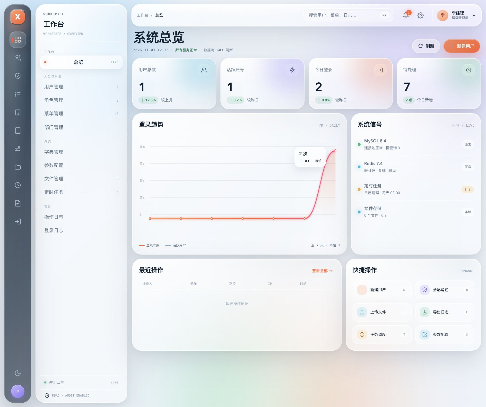
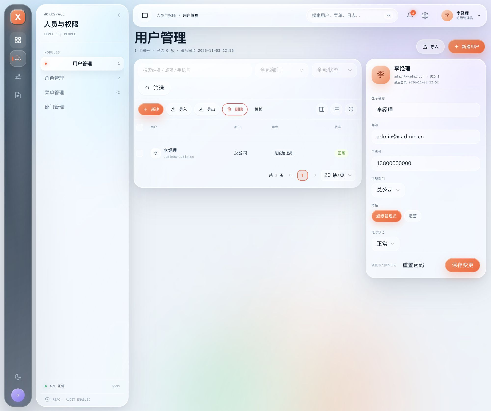
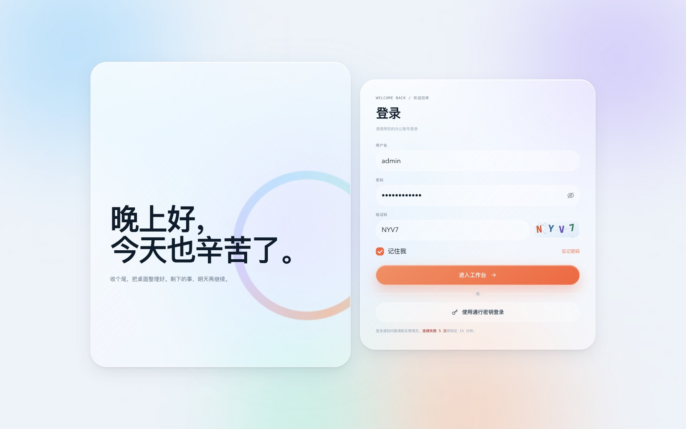
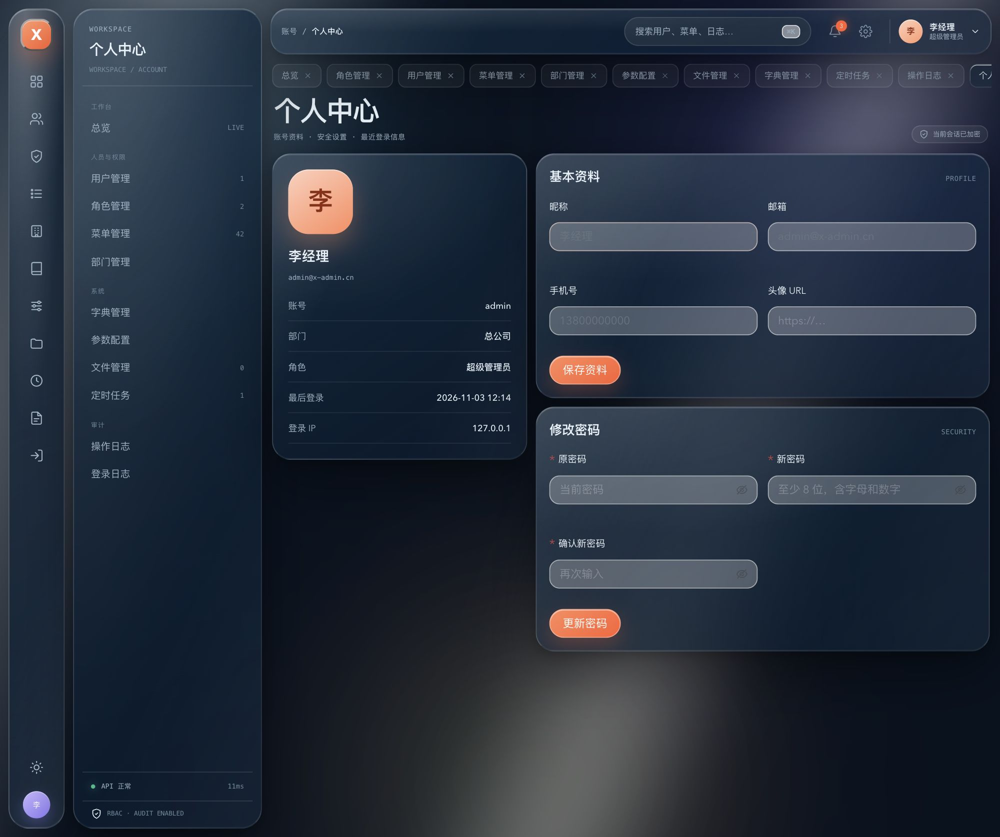

<div class="docs-hero" markdown>

# x-admin 框架文档

<p class="docs-hero__lead">通用 RBAC 管理后台 · Go + React 前后端分离。这里沉淀框架的设计取舍、扩展方式与实现契约，写给要在这套脚手架上继续加功能的人。</p>

<p class="docs-hero__actions">
<a class="md-button md-button--primary" href="https://github.com/xgd16/x-admin#5-快速开始">快速开始</a>
<a class="md-button" href="#document-map">浏览文档</a>
</p>

</div>

## 文档地图 {#document-map}

<div class="grid cards" markdown>

-   :material-transit-connection-variant:{ .lg .middle } __wire 依赖注入教程__

    ---

    从手写装配到 wire 生成。跟着做一个「公告」模块，掌握新增功能的标准动作，附报错急救对照表。

    [:octicons-arrow-right-24: 开始阅读](wire-tutorial.md)

-   :material-file-export:{ .lg .middle } __异步导出框架__

    ---

    列表点「导出」只提交任务，后台 worker 游标分批生成 xlsx。讲清任务生命周期，以及给新模块接入导出。

    [:octicons-arrow-right-24: 开始阅读](export.md)

-   :material-shield-account:{ .lg .middle } __前台用户认证__

    ---

    在后台身份体系之外，用独立模型、TokenManager 与中间件接入前台用户登录的完整演示。

    [:octicons-arrow-right-24: 开始阅读](front-auth.md)

-   :material-clipboard-check-outline:{ .lg .middle } __系统实现规格（SPEC）__

    ---

    技术栈、目录约定、权限模型、接口规范与开发约定——新增模块前先对齐的实现契约。

    [:octicons-arrow-right-24: 查看契约](spec.md)

</div>

## 项目一览

<div class="shot-grid">
  <figure>
    
    <figcaption>工作台看板</figcaption>
  </figure>
  <figure>
    
    <figcaption>用户管理</figcaption>
  </figure>
  <figure>
    
    <figcaption>登录页</figcaption>
  </figure>
  <figure>
    
    <figcaption>个人中心 · 深色模式</figcaption>
  </figure>
</div>

## 技术栈与官方文档

| 层 | 选型 | 官方文档 |
| --- | --- | --- |
| 后端语言 | Go 1.27 | [go.dev/doc](https://go.dev/doc/) |
| Web 框架 | Gin | [gin-gonic.com](https://gin-gonic.com/zh-cn/docs/) |
| ORM | GORM | [gorm.io](https://gorm.io/zh_CN/docs/) |
| 依赖注入 | Google wire | [wire 指南](https://github.com/google/wire/blob/main/docs/guide.md) |
| 数据库 | MySQL 8.4 | [dev.mysql.com/doc](https://dev.mysql.com/doc/) |
| 缓存 | Redis 7.4 | [redis.io/docs](https://redis.io/docs/latest/) |
| 前端框架 | React 19 | [zh-hans.react.dev](https://zh-hans.react.dev/) |
| 组件库 | Ant Design 6 | [ant.design](https://ant.design/components/overview-cn) |
| 构建 | Vite 8 | [cn.vite.dev](https://cn.vite.dev/) |

框架如何在代码里落地，见 [系统实现规格](spec.md)；认证、导出、依赖注入三条主线各有专题文档。

## 本地预览

本站由 MkDocs Material 构建，源码就是仓库里的 Markdown：

```bash
# 安装文档依赖（建议在虚拟环境中）
pip install -r docs-requirements.txt

# 本地预览，默认 http://127.0.0.1:8000/
mkdocs serve
```

推送到 `main` 且改动命中 `docs/**`、`SPEC.md`、`mkdocs.yml` 时，GitHub Actions 会自动构建并发布到 GitHub Pages。
